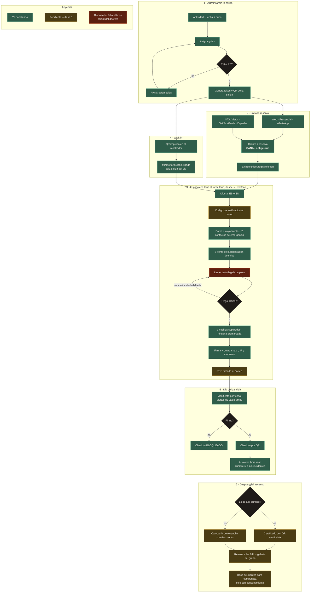

# Flujos y reglas de negocio

## El recorrido completo

## Reglas que el servidor hace cumplir

No son validaciones del navegador: están en el servidor, donde no se pueden
saltar.

| Regla | Por qué |
|---|---|
| **Sin firma no hay check-in** | Es el punto donde el papel servía de respaldo legal |
| **La aceptación de riesgo es obligatoria** | Restricción en base de datos, no sólo en la aplicación |
| **Un menor exige nombre y documento del tutor** | Lo pide el formulario legal |
| **Edad mínima por actividad** | Evita que alguien reserve algo que no puede hacer |
| **Primer contacto de emergencia obligatorio** | El decreto pide dos; uno es el mínimo operativo |
| **Un formulario por reserva** | `registro.reserva_id` es único: no se firma dos veces |

## Reglas de interfaz que importan legalmente

- **La casilla de aceptación de riesgo se habilita sólo al llegar al final del
  texto.** Nadie puede alegar que no lo leyó.
- **Tres casillas separadas, ninguna premarcada.** Aceptar el riesgo no puede
  implicar autorizar el uso de tu cara ni recibir publicidad.
- **El documento se emite completo en el idioma firmado.** Encabezados y
  declaración en el mismo idioma: quien firma tiene que poder leerlo entero.

## Lo que el prototipo todavía no hace

- Enviar correos. El botón de recordatorio muestra a quién se le enviaría.
- Mandar el código de verificación. Registra `metodo_verificacion = email`
  pero no lo ejecuta.
- PDF binario archivado. Hoy es vista imprimible.
- Autenticación. `/admin` está abierto.
