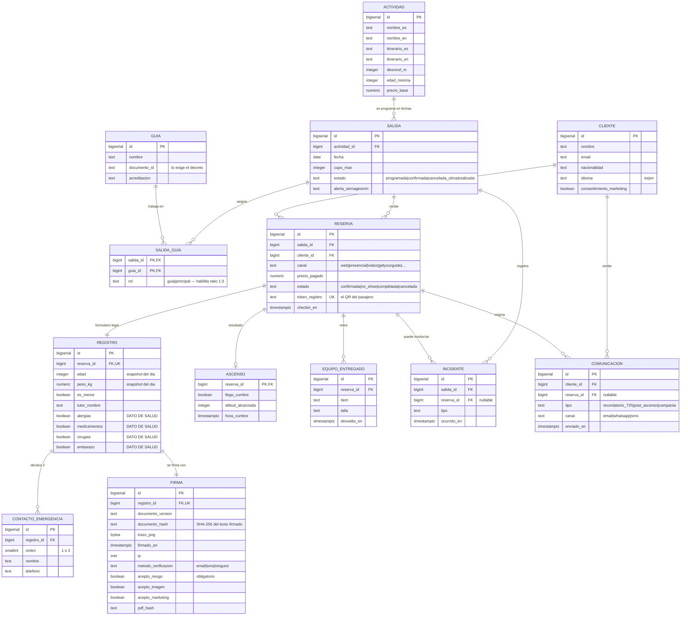

# Modelo de datos

El esquema ejecutable vive en [`../../../sistema/schema.sql`](../../../sistema/schema.sql)
(PostgreSQL). Este documento explica **por qué** está así; el SQL es la verdad.

## Las tablas

| Tabla | Para qué |
|---|---|
| `guia` | Nombre y **documento de identidad**, que el formulario legal exige explícitamente |
| `actividad` | El tour: lugares, itinerario, desnivel, edad mínima. Campos `_es` y `_en` |
| `salida` | Una fecha concreta de una actividad, con cupo, estado y alerta volcánica |
| `salida_guia` | Varios guías por salida → permite verificar la **ratio 1:3** |
| `cliente` | La persona. Su idioma y su consentimiento de marketing con fecha |
| `reserva` | Une cliente y salida. Lleva **`canal`** |
| `registro` | El formulario legal: los 8 ítems de la declaración, edad, peso, tutor |
| `contacto_emergencia` | Los **dos** contactos que pide el decreto, con `orden` 1 y 2 |
| `firma` | El paquete de prueba de la firma electrónica |
| `ascenso` | Llegó o no a la cumbre, altitud alcanzada |
| `equipo_entregado` | Qué se le dio, en qué talla, y si lo devolvió |
| `incidente`, `comunicacion` | Registro de seguridad y de mensajes enviados |

## Las cuatro decisiones que importan

### 1. Los datos de la actividad viven en `salida`, no en cada formulario

El papel repite guía, fecha, horas, lugares e itinerario **en cada hoja**. Para
doce pasajeros se escribe doce veces lo mismo, y basta un error del guía para
que queden inconsistentes.

Acá se cargan una vez y el PDF de cada pasajero se arma fusionando
`salida` + `actividad` + `registro`. Doce PDF consistentes, un solo tipeo.

### 2. `reserva.canal` es obligatorio

`web | presencial | whatsapp | telefono | viator | getyourguide | expedia | tripadvisor | otro`

Es el campo más valioso del sistema: **es lo único que permite saber cuánta
plata se va en comisiones contra cuánto entra directo.** Hoy ese número no
existe en la agencia. Con tres meses de datos se tiene la cifra exacta de la
fuga, y ese número es el que justifica invertir en el canal propio.

### 3. `registro` guarda snapshot, no referencia

`edad` y `peso_kg` viven en `registro`, no en `cliente`. El documento legal
debe reflejar **lo declarado ese día**. Si alguien sube tres veces en dos años,
cada formulario conserva su propia edad.

### 4. `firma` es un paquete de prueba, no un dibujo

Bajo la Ley 19.799 la firma electrónica simple es válida entre privados. Lo que
la sostiene no es el trazo:

| Campo | Para qué |
|---|---|
| `documento_version` + `documento_hash` | Probar **qué** texto firmó. SHA-256 del texto exacto |
| `trazo_png` | El gesto |
| `firmado_en`, `ip`, `user_agent` | Cuándo y desde dónde |
| `metodo_verificacion`, `verificado_en` | Que era él y no cualquiera |
| `acepto_riesgo` / `acepto_imagen` / `acepto_marketing` | Tres consentimientos **separados**, cada uno con su fecha |
| `pdf_hash` | Que la copia enviada es la que se firmó |

Restricción `riesgo_obligatorio`: no existe una firma sin aceptación de riesgo.

## Datos sensibles

`alergias`, `medicamentos`, `cirugias` y `embarazo` son **datos de salud**.
Bajo la Ley 19.628 y la Ley 21.719 tienen protección reforzada.

Pendiente de definir: **plazo de conservación** y **quién los ve**. Deberían
ser visibles para el guía de esa salida, no para todo el personal. Hoy el
prototipo no lo restringe porque no tiene autenticación.

## La vista `v_manifiesto`

Responde de una la pregunta que hoy obliga a revisar carpetas: *¿quién subió el
14 de marzo?* Incluye una columna `alerta_salud` que marca al pasajero con
cualquier condición declarada.
